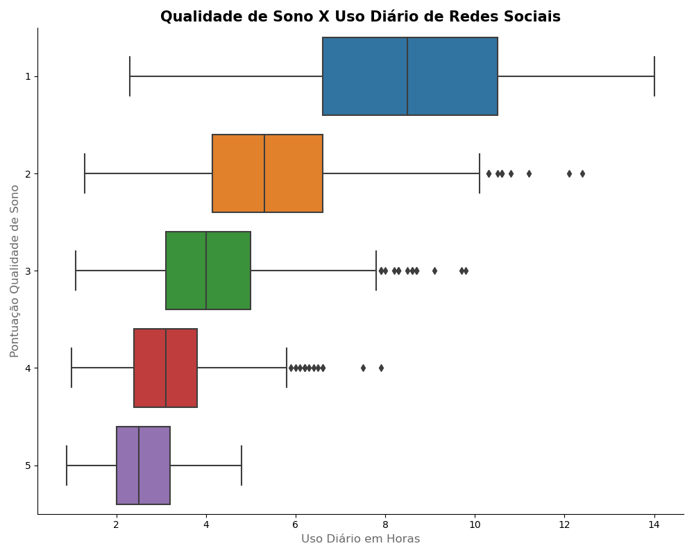
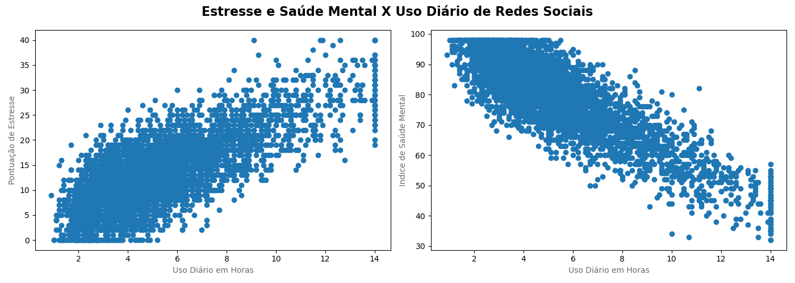

# 📱 Análise de Dados: Impacto das Redes Sociais no Sono e Saúde Mental

## 📌 O Desafio (Business Question)
Este projeto de análise exploratória investiga como o volume diário de horas gasto em redes sociais afeta diretamente os níveis de stresse, a saúde mental e a qualidade do sono dos estudantes. O objetivo é identificar padrões de risco e provar, através de dados, a correlação entre o tempo de ecrã e o bem-estar psicológico.

## 🛠️ Ferramentas e Técnicas Utilizadas
* **Linguagem:** Python
* **Bibliotecas:** Pandas (manipulação de dados), Matplotlib e Seaborn (visualização e design de informação)
* **Técnicas Aplicadas:** Análise de distribuição com *Boxplots*, correlação multivariável com *Scatter Plots*, limpeza de ruído visual (Data-Ink Ratio) e estruturação de painéis analíticos (`subplots`).

## 📊 Principais Descobertas (Insights)

### 1. O Sono Exige Desconexão
A análise de distribuição cruzada provou que existe uma relação inversamente proporcional entre o uso de redes sociais e o descanso.
* Estudantes com a **pior qualidade de sono (Nota 1)** apresentam uma mediana de **8 a 9 horas diárias** de uso.
* Em contraste, a esmagadora maioria dos estudantes com **sono excelente (Nota 5)** não ultrapassa a marca das **3 a 4 horas diárias**.



### 2. O Custo Oculto no Stresse e Saúde Mental
Ao cruzar o tempo de ecrã com indicadores psicológicos, os dados formam uma tendência incontestável:
* **Stresse Percebido:** Quanto maior o uso diário, mais a concentração de dados sobe no eixo de stresse.
* **Saúde Mental:** O índice colapsa de forma agressiva à medida que a dependência das plataformas aumenta, evidenciado pela inclinação negativa da dispersão.



## 🚀 Como Executar o Projeto

1. Clone este repositório:
   ```bash
   git clone [https://github.com/grtpotato098/impacto-redes-sociais-saude.git](https://github.com/grtpotato098/impacto-redes-sociais-saude.git)
